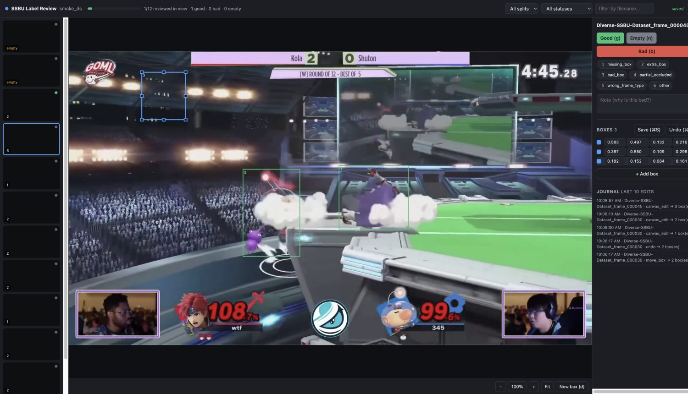
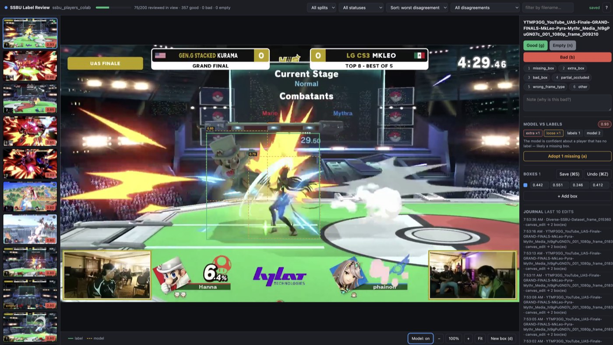
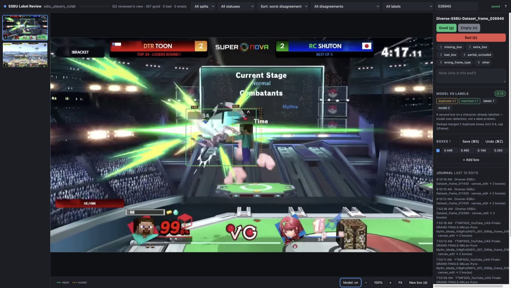
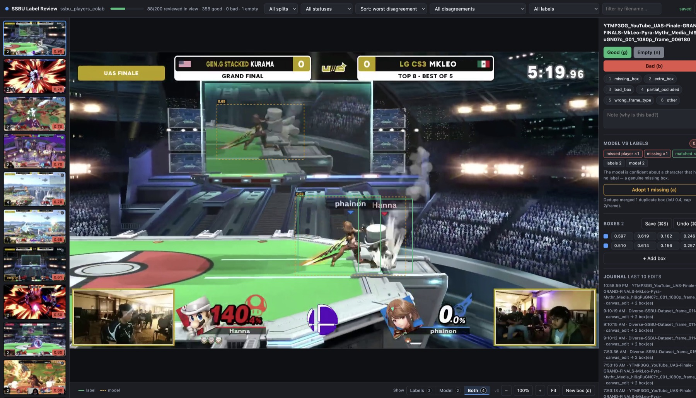

# Label review app

A local, zero-dependency browser app for **reviewing and correcting YOLO bounding-box
labels in place**. It replaces the review half of the CVAT workflow: no accounts, no
uploads, no servers to run, no new Python packages.

```bash
source .venv/bin/activate
python scripts/stage_dataset.py
python app/server.py --dataset .staging/ssbu_players_colab
# open http://localhost:8770
```

> Run from the repo root with the venv active. The system `python3` lacks `pyyaml`,
> so `.venv/bin/python` (or an activated venv) is required. Avoid pasting command
> lines with trailing `#` instructions — in zsh they are passed as arguments, not
> ignored as comments.



## Two modes: label and view

| URL | Mode | What it does |
| :--- | :--- | :--- |
| `/review?dataset=…&bounty_id=…` | **Label** | Writable. Scoped to one bounty's fixed slice; nothing outside it appears. Needs a bounty. |
| `/view?dataset=…` | **View** | Read-only. Every frame in the dataset, plus the source video. No bounty needed. |

`/review` without a `bounty_id` redirects to the landing screen, because labelling
frames that no bounty is paying for is never what you meant to do. On the landing
screen, **View** sits at the top of each dataset card and **Label** on each bounty
row.

**`g` requires at least one box.** A frame with no players is `n` (Empty). This is
enforced by the API as well as the UI: a frame marked good with an empty label file
is counted as reviewed but contributes nothing to training, so it is treated as a
data error rather than a review. If such frames already exist, the app offers a
**Reset to unreviewed** repair on load.

## Why it exists

CVAT is web-first and paywalled, and streaming the dataset from Drive measured
~0.5 MB/s, which made a single training epoch take 30+ minutes. Reviewing 3,857 images
over that mount would be unusable, and writing into a synced cloud mount risks sync
conflicts. So: **images stay local, only the tiny `.txt` labels sync back.**

## Requirements

None beyond what is already installed. The backend is Python standard library only
(`http.server`), and the UI is vanilla JS on a `<canvas>` with no build step. `cv2` and
`pyyaml` are reused from the existing `requirements.txt` for thumbnails and path config.

Verified on the project's existing Python 3.9.6 `.venv`.

## Workflow

1. **Stage** the dataset locally (one-time, ~2 GB):
   ```bash
   python scripts/stage_dataset.py
   ```
   Extracts `ssbu_players_colab.zip` from Drive into `.staging/`. Re-running is a no-op
   once staged; pass `--force` to re-extract.

2. **Review**:
   ```bash
   python app/server.py --dataset .staging/ssbu_players_colab
   ```
   Open <http://localhost:8770>.

3. **Sync back** to Drive — prints a diff summary and writes nothing until you pass
   `--to-drive`:
   ```bash
   python scripts/sync_labels.py --dataset .staging/ssbu_players_colab --dry-run
   python scripts/sync_labels.py --dataset .staging/ssbu_players_colab --to-drive
   ```

## Why you only see ground-truth labels at first

Out of the box the app shows the **dataset's own annotations** for `train` and `val`.
Those are human labels, not model output. Training scores `val` (mAP50 0.9228 for
`smash_player_colab_v2`) and then *discards* the predictions, so nothing on disk says
where the model agreed or disagreed.

Two consequences worth knowing:

- The `train` split sorts first and holds 3,085 of the 3,857 images, so `val` — the
  held-out set — does not appear until you page a long way. **Use the split filter.**
- Reviewing `val` labels tells you whether your *labels* are right. It says nothing
  about whether the *model* is right. That needs predictions.

## Prediction overlay and disagreement ranking

Run the checkpoint over a split in Colab, then point the app at the result:

```bash
# In Colab: notebooks/predict_ssbu_colab.ipynb  (or scripts/predict_ssbu.py --split val)
python app/server.py --dataset .staging/ssbu_players_colab \
    --predictions "<drive>/exports/predictions/smash_player_colab_v2"
```

Optional thresholds (defaults suit this 1v1 dataset):

```bash
python app/server.py --dataset .staging/ssbu_players_colab \
    --predictions "<drive>/exports/predictions/smash_player_colab_v2" \
    --nms-iou 0.40 --max-boxes 2
```



Duplicate detections are merged and the per-frame count capped, so the overlay shows the
characters rather than the detector's double-fires:



With predictions loaded, the app draws the model's boxes **dashed orange** over your
labels and ranks the strip by disagreement instead of filename. `p` toggles the overlay.

### Choosing which boxes are on screen

The segmented control in the stage footer switches the canvas between the two box sets.
It is prefixed with `Show` so the numbers read as counts rather than a score. Each
segment carries the number of boxes it would draw, so you can read the counts without
leaving the view you are in.

| Segment | Shows | Count | Editable |
| --- | --- | --- | --- |
| **Labels** | your ground-truth boxes only | your labels | yes |
| **Model** | the model's predictions only (solid strokes, confidence tags) | cleaned predictions | no |
| **Both** | predictions dashed underneath your labels | labels + predictions | yes |

`Both` is the default and the only view where editing and adopting are enabled, since
both actions need the label set visible to act on. Pressing <kbd>p</kbd> cycles the three
modes; the legend hides whichever key is not currently painted.

Switching announces what is now on screen — `Showing 2 labels + 2 predictions (editable)`
— because on a frame where the two sets sit almost on top of each other the canvas itself
barely changes, which makes the control feel dead.



A small **`v3`** stamp sits at the right of the footer. It is the UI build, and it exists
purely for diagnostics: if it is missing, or older than the code you expect, the page is
stale and needs a hard reload (<kbd>⌘⇧R</kbd>). Bump `UI_VERSION` in `app/static/app.js`
along with the `?v=` query on the asset tags in `index.html` when the UI changes.

Switching to **Model** disables box editing rather than hiding it silently: the draw and
add-box buttons grey out and the box list becomes inert, so a click cannot select a label
that is off screen. The `Labels` view is the one to use for label hygiene work — the
`Over-labelled (>2 boxes)` filter plus nothing else on the canvas.

### How disagreement is scored

Labels and predictions are matched greedily by IoU (>= 0.50 counts as agreement,
below 0.10 counts as unrelated). An unmatched prediction then splits into two very
different cases, and telling them apart is the point:

| Signal | Weight | Meaning |
| --- | --- | --- |
| **Unlabelled player** | 0.80 | Overlaps **no** label. The model sees a character nobody labelled — the one case that reliably means a label is genuinely missing. |
| **Label not found** | 0.35 | A labelled box the model cannot find. Either the label sits on nothing (bad label) or the model missed the player. |
| Loose fit | 0.25 | Matched, but IoU below 0.50. The label is roughly right but loosely drawn. |
| **Duplicate** | 0.15 | Overlaps a label substantially: the detector fired twice on one character. Model noise, **not** a label error. |

These names are deliberately different from the review reason codes. The reason code
`missing_box` means *"a player is visible but has no box"* — a box should be **added** —
which is the opposite of **Label not found** here, where a box exists that the model
cannot see. Naming both the same made the two vocabularies contradict each other.

Low-confidence extras (below 0.50 confidence) score zero; they are usually model noise.
Scores are clamped to 1.0, and the `kind` filter jumps straight to one category.

Getting duplicate vs missed-player right matters: a duplicate landing in the missed-player
bucket would invite you to add a second box on a character that already has one, teaching
the model to double-fire.

### Dedupe and the 2-box cap

The dataset here is strictly 1v1, so two boxes is a hard ceiling and anything more is the
detector double-firing. Measured on `val`, the model put 3+ boxes on **7.8%** of frames
and 80% of its unmatched detections were duplicates of an already-labelled character
(median IoU 0.42, versus 0.00 for genuinely unrelated detections).

Predictions are therefore corrected on read, with one shared implementation used by both
the review app and `scripts/predict_ssbu.py`:

| Stage | Default | Effect on `val` |
| --- | --- | --- |
| Merge overlaps above `--nms-iou` | 0.40 | duplicates 26 -> 9 |
| Cap at `--max-boxes` per frame | 2 | frames with >2 boxes: 60 -> **0** |

Both knobs are exposed on the server and on the inference script. Suppression runs
**before** the cap, so the survivors are the real characters rather than an arbitrary
first-N that could include a double. Pass `--max-boxes 0` to dedupe without capping.

The stored predictions stay raw. Corrections are re-derived on every read, so changing a
threshold needs no re-run, and the original detections are always recoverable.

### Adopting a prediction as a label

A prediction the labels do not already cover is the interesting case: either a character
you missed or a model hallucination. The app can promote it to a label, so you inspect and
confirm rather than redraw the box by hand.

| Action | Effect |
| --- | --- |
| click a dashed box | adopts **that** prediction (cursor turns to `copy` when hovering an adoptable one) |
| `a` / **Adopt N missing** | adopts every unmatched prediction with confidence >= 0.50 |

Only **missed players** are adoptable. A duplicate is never offered, so you cannot
accidentally write a double box into ground truth. After adopting, the score for that
image is recomputed and the strip re-ranks; the button hides once nothing is left.
`cmd+Z` (or **Undo**) reverts an adopt byte-for-byte.

### Finding over-labelled images

The `All labels` filter isolates label hygiene problems:

| Option | Shows |
| --- | --- |
| Over-labelled (>2 boxes) | 20 files across train+val — impossible for 1v1, so each is over-annotation |
| No labels | background frames with no boxes |
| Malformed | lines that failed to parse |

### Scores follow your edits

Only **raw** predictions are stored. Disagreement is always recomputed against the
labels currently on disk, so fixing a box immediately updates that image's score
instead of leaving a stale number behind. Adopting a box also refreshes the score from
the save response, so the ranking reflects your change without a page reload.

## Reviewing

Left: thumbnail strip with a status dot per image and the box count (`empty` when there
are none). Center: the image with its boxes. Right: review controls, editable box
coordinates, warnings, and a live journal of recent edits.

### Marking images

| Action | Key | Notes |
|---|---|---|
| Mark good | `g` | Save and advance |
| Mark bad | `b` | Pick reasons first; does not advance until you do |
| Mark reviewed empty | `n` | For intentional background frames |
| Next unreviewed | `u` | Jumps to the next unreviewed image in the current filter |

**Empty is a first-class state, not an error.** 877 of the 3,857 images are intentional
backgrounds. `n` marks "I looked, there is correctly nothing here", which is different
from leaving an image unreviewed.

Bad reasons: `missing_box`, `extra_box`, `bad_box`, `partial_occluded`,
`wrong_frame_type` (menu/HUD/not gameplay), `other` + free-text note. Toggle with
`1`–`6` or by clicking a chip while the image is marked bad.

### Editing boxes

- **Move:** drag a box.
- **Resize:** drag one of the 8 handles on the selected box.
- **Add:** press `d` (or *New box*) then drag on the image, or *+ Add box* for a
  centered default box.
- **Delete:** select and press `Delete` / `Backspace`, or click `×` in the box list.
- **Type exact values:** the `xc`/`yc`/`w`/`h` fields in the right panel.
- **Zoom/pan:** scroll to zoom at the cursor, drag empty space to pan, *Fit* to reset.

### Full keyboard map

| Key | Action |
|---|---|
| `j` / `k`, `↓` / `↑` | next / previous image |
| `u` | next unreviewed image |
| `g` | mark good (advances) |
| `b` | mark bad |
| `n` | mark reviewed empty (advances) |
| `d` | toggle draw-new-box mode |
| `1`–`6` | toggle bad reason |
| `Delete` / `Backspace` | delete selected box |
| `Esc` | deselect / cancel draw |
| `⌘Z` / `⌘⇧Z` | undo / redo |
| `⌘S` | save now |
| `?` | shortcut overlay |

Edits **autosave** ~1 s after you stop changing anything; the top bar shows
`saved` / `unsaved…`. `⌘S` forces it.

## Data safety

Editing label files directly is dangerous if done carelessly, so the app is built around
guarantees that are enforced by tests in `app/selftest.py`:

- **Byte-identical no-op.** Parsing and re-serializing an untouched file reproduces it
  byte-for-byte, so a review session that changes nothing rewrites nothing.
- **CRLF is preserved.** The real dataset uses Windows line endings. Edits keep the
  file's original endings rather than silently converting every edited file to LF, which
  would otherwise show up as a whole-file diff on Drive.
- **Atomic writes.** Labels serialize to a `.tmp` file then `os.replace`, so an
  interrupted write can never leave a half-written label file.
- **Recovery copy on first edit.** The first time a file is edited in a session, the
  pristine original is copied to `.review/backups/`.
- **Append-only journal.** Every change appends before/after boxes, timestamp, image id,
  and newline style to `.review/edits.jsonl`. *Undo* in the UI (or `POST /api/undo/<id>`)
  reverts the last recorded edit for an image.
- **Malformed rows are preserved.** Unparseable lines are kept and surfaced as warnings,
  never dropped. (Note: `scripts/prepare_cvat_import.py`'s `clean_label_lines` discards
  rows with fewer than 5 parts — that logic must not be reused for editing.)
- **Clamping.** Coordinates clamp to `[0,1]`, degenerate boxes are dropped, and values
  round to 6 decimals to match the existing files.
- **Never touched:** `data.yaml`, `split_manifest.json`, `train.cache`, `val.cache`.
- **Non-UTF-8 files are read-only.** If a label file cannot be decoded, editing it is
  refused rather than corrupted.
- **Path guards.** Image ids resolve inside the dataset root; traversal attempts are
  rejected.
- **Cloud guard.** The server refuses to edit a dataset under `/CloudStorage/` or
  `/content/drive` unless you pass `--allow-cloud`, and points you at `stage_dataset.py`.

`sync_labels.py` never writes into the staged dataset's own `images/` or `labels/`
folders, and refuses to run while a training run looks active (recently written
`results.csv` / `best.pt` under `runs/`) unless you pass `--force`.

## HTTP API

Sample ids are split-relative paths, e.g. `train/Diverse-SSBU-Dataset_frame_000090`.

| Method | Path | Purpose |
|---|---|---|
| `GET` | `/api/dataset` | dataset name, split counts, review progress, reason codes |
| `GET` | `/api/samples?split=&status=&q=&offset=&limit=` | paged samples with box counts and status |
| `GET` | `/api/sample/<id>` | image size, parsed boxes, review record, warnings |
| `GET` | `/api/image/<id>` | full-resolution image |
| `GET` | `/api/thumb/<id>` | filmstrip thumbnail (precomputed file, else a cv2 downscale) |
| `PUT` | `/api/sample/<id>/labels` | replace boxes (atomic write + journal + backup) |
| `POST` | `/api/sample/<id>/review` | set status, reasons, note |
| `POST` | `/api/undo/<id>` | revert the last journaled edit |
| `GET` | `/api/journal` | recent journal entries |
| `GET` | `/api/export/review.csv` | review decisions as CSV |

## Tests

```bash
python app/selftest.py
```

378 assertions covering round-trip byte identity (including CRLF and blank lines),
malformed-row preservation, clamping, degenerate boxes, decode safety, atomic
save/journal/backup/undo, path traversal, cache protection, and review-store
persistence. No test framework required.

## Verified behaviour

### Full-dataset safety scan

Every one of the **3,857 real label files** was read through `label_io` and re-serialized
with no changes applied (read-only, nothing written):

```
files                 : 3857
line endings          : CRLF=2980  LF=877
intentionally empty   : 877
box count histogram   : {0: 877, 1: 672, 2: 2288, 3: 19, 4: 1}
non-UTF-8 (read-only) : 0
files w/ malformed    : 0
>>> NO-OP ROUND TRIP BYTE-IDENTICAL: 3857/3857
```

**All 2,980 non-empty label files use CRLF** line endings (the 877 LF entries are the
877 empty files). This is why newline preservation was not optional: without it, editing
any of those 2,980 files would have rewritten every line in the file and produced a
whole-file diff on Drive. The byte-identity result above covers all 3,857 files.

### Review targets found

The box-count histogram surfaces the frames most likely to be wrong. All 3- and 4-box
frames come from one source video:

- **4 boxes** (1 frame) — `val/YTMP3GG_…hI9gPuGN07c_001_1080p_frame_027420`
- **19 frames with 3 boxes** across `train/` and `val/` from the same video

These are worth checking first — a fourth `player` box on a two-player stage is a
probable extra-box error. The box-count badge on each thumbnail and the `status` filter
make them easy to page through.

### Interactive checks

Verified against the real dataset via `curl` and a driven browser session:

- No-op save on a real CRLF label file leaves the bytes identical.
- Moving, deleting, and drawing boxes all persist to disk with CRLF intact (0 bare LF).
- A drawn box landed at `0 0.181564 0.152390 0.083799 0.161390`.
- `POST /api/undo` restored a file byte-identical to the pristine Drive original.
- A recovery copy was written before each first edit per session.
- Editing a box and navigating away before the autosave debounce elapsed saved the edit
  and updated the correct thumbnail.
- Invalid reason codes are rejected with HTTP 400; traversal attempts 403/404.
- Disagreement ranking ordered a known fixture correctly: confident extra 0.73 >
  missing 0.35 > loose fit 0.25 > low-confidence extra 0.00 > agreement 0.00.
- The overlay painted prediction boxes on the canvas (~1,990 orange pixels) and `p`
  removed every one of them without disturbing the labels.
- First real run (`smash_player_colab_v2` over all 772 `val` images, 1,086 boxes, 30.8s
  on a Colab T4): 77.5% full agreement, 128 images flagged at >= 0.25.
- Adopting all 3 unmatched predictions on a test image took 1 label to 4 and the score
  from 0.80 to 0.00, with `\r\n` preserved on every line including the new ones.
- Undo after an adopt restored the label file to a byte-identical SHA-256.
- Dedupe + cap on the real `val` predictions: 1,086 raw boxes -> 992, frames with more
  than 2 boxes 60 -> 0, duplicates 26 -> 9, full agreement 598 -> 646.
- A duplicate is classified `duplicate` (score 0.15) and **not** offered for adoption;
  the same detections previously scored ~0.80 as `extra_box` with an Adopt button.
- The real Drive dataset was never modified.

## Out of scope (this pass)

Tracking/distance/event annotation (Phase 1B), multi-class labels, and polygons.

## Thumbnails

The filmstrip shows 200 tiles at 160 px wide. Serving the source frame for each
tile is ~90 MB per 250-frame bounty, and the server cannot shrink an image itself
(it is stdlib-only, so a normal install has no cv2, Pillow or ffmpeg).

So thumbs are written wherever cv2 is already a requirement:

| Producer | Writes |
|---|---|
| `scripts/ingest_video.py` | `thumbs/<split>/<stem>.jpg` beside every saved frame |
| `scripts/make_thumbs.py` | the same path, for datasets ingested before thumbs existed |

```bash
.venv-train/bin/python scripts/make_thumbs.py data/datasets/ultrank_11_20
```

`/api/thumb/<id>` then serves that file directly. Datasets without a `thumbs/`
tree still work: the server falls back to cv2 if it is installed, and to the
full-size image if not. Re-running ingest also repairs missing thumbs without
re-encoding the frames.

Thumbs are ignored by git and published inside the `images-<dataset>` release
bundle, so `bounty.py fetch --dataset ...` brings them along.

Inference deliberately runs in Colab rather than locally: `torch` and `ultralytics`
are not in this venv and would add roughly 2 GB to it. The app only reads the small
JSON the notebook writes.

Built with patterns from MIT-licensed prior art — see [prior_art.md](prior_art.md).
